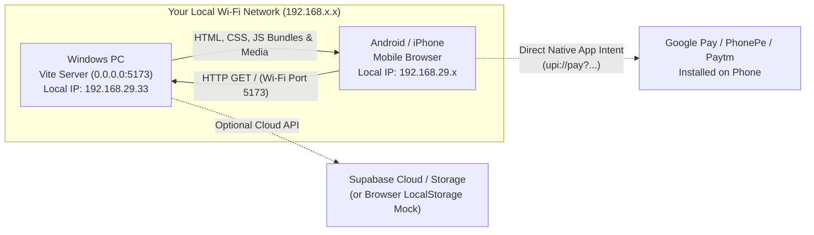

# RA Guppy — Local Mobile Access & Testing Guide
## How to Run & Test on Android or iPhone from your Windows PC Without Public Hosting

This guide explains how to run the live **RA Guppy** e-commerce website on your physical mobile device (Android or iOS) using your Windows PC as the local development host. No cloud deployment, domain registration, or external hosting fees are required.

---

## 1. How It Works (Local Network Architecture)



- **Zero Cloud Deployment**: Your computer runs the Vite development server and acts as the local web host.
- **Local Network Binding (`0.0.0.0`)**: Vite listens on all network adapters, allowing your phone on the same Wi-Fi to request pages directly via your PC's private IP address.
- **Client-Side Self-Containment**: In mock database mode (`mockDb`), product data, orders, and cart items persist directly inside the mobile browser's `localStorage`. When cloud Supabase is configured, the mobile browser connects directly to the Supabase HTTPS endpoints.
- **Native Mobile Features**: Direct UPI app launching (`Google Pay`, `PhonePe`, `Paytm`), camera capture for payment slips, touch gestures, and PWA installation work natively on your phone.

---

## 2. Quick Start: 1-Click Windows Launcher

We have provided a Windows batch script in your project root: [`start-mobile.bat`](file:///e:/betta%20aquatics/start-mobile.bat).

1. Double-click **`start-mobile.bat`** in File Explorer (or run `.\start-mobile.bat` from terminal).
2. The script will automatically:
   - Verify that **Node.js** and **npm** are installed.
   - Verify that project dependencies exist.
   - Detect your PC's active Wi-Fi IPv4 address (e.g. `192.168.29.33`).
   - Print the exact Mobile Network URL in bold.
   - Launch Vite with `--host 0.0.0.0 --port 5173 --strictPort`.
3. Open your mobile browser (Chrome on Android or Safari on iPhone) and navigate to the printed URL:
   ```text
   http://192.168.29.33:5173/
   ```

*(Note: Replace `192.168.29.33` with whatever IP address `start-mobile.bat` prints for your machine).*

---

## 3. Manual Command Line Start

If you prefer using your terminal or PowerShell directly:

```powershell
# Open terminal in project directory
cd "e:\RA Guppy"

# Start Vite with local network access
npm run dev -- --host 0.0.0.0
```

Vite will start and display both access addresses:
```text
  ➜  Local:   http://localhost:5173/
  ➜  Network: http://192.168.29.33:5173/
```

---

## 4. How to Find Your PC's IPv4 Address Manually

If your Wi-Fi router assigns a new IP address to your computer, find it anytime using either method:

### Method A: Command Prompt / PowerShell
1. Open PowerShell or Command Prompt.
2. Run:
   ```powershell
   ipconfig
   ```
3. Look for your active adapter (usually **Wireless LAN adapter Wi-Fi**).
4. Find the line:
   ```text
   IPv4 Address. . . . . . . . . . . : 192.168.29.33
   ```
5. Your mobile URL is: `http://<IPv4_Address>:5173/`

### Method B: Windows Settings
1. Open **Settings** $\rightarrow$ **Network & internet** $\rightarrow$ **Wi-Fi**.
2. Click on your connected Wi-Fi network properties.
3. Scroll to the bottom and copy the **IPv4 address**.

---

## 5. Windows Defender Firewall Configuration

By default, Windows Defender Firewall may block incoming connections from other devices on your local network.

> [!IMPORTANT]
> **Security Rule**: Never disable Windows Firewall entirely, and never configure port forwarding on your internet router. Only open port `5173` on the **Private Network** profile.

### Quick Setup: PowerShell (Recommended)
Open PowerShell as **Administrator** and run this single command:

```powershell
New-NetFirewallRule -DisplayName "RA Guppy Dev Server" -Direction Inbound -LocalPort 5173 -Protocol TCP -Action Allow -Profile Private
```

### Manual Setup via Windows Settings (Alternative)
1. Open **Windows Security** $\rightarrow$ **Firewall & network protection**.
2. Click **Advanced settings** (opens Windows Defender Firewall with Advanced Security).
3. In the left sidebar, click **Inbound Rules** $\rightarrow$ in the right sidebar, click **New Rule...**.
4. Select **Port** $\rightarrow$ Click Next.
5. Select **TCP** $\rightarrow$ Enter Specific local ports: `5173` $\rightarrow$ Click Next.
6. Select **Allow the connection** $\rightarrow$ Click Next.
7. **Crucial**: Check **Private** ONLY. Uncheck **Public** and **Domain** $\rightarrow$ Click Next.
8. Name it `RA Guppy Dev Server` $\rightarrow$ Click **Finish**.

---

## 6. Accessing & Testing on Mobile Devices

### A. Android Setup (Google Chrome, Samsung Internet, Brave)
1. Ensure your Android phone is connected to the **same Wi-Fi network** as your PC.
2. Open **Google Chrome**.
3. Type: `http://<YOUR_PC_IP>:5173/` (e.g. `http://192.168.29.33:5173/`).
4. **Install as PWA**:
   - Tap the three-dot menu icon ($\vdots$) in the top-right corner.
   - Select **Add to Home screen** or **Install app**.
   - An app icon titled **RA Guppy** with the betta logo will appear on your phone's home screen.
5. **Testing UPI Payment**:
   - Add a specimen to your cart $\rightarrow$ Proceed to Checkout.
   - Under Payment, tap **Pay Now via UPI App**.
   - Your Android phone will trigger native app selection (Google Pay, PhonePe, Paytm, BHIM) with the exact order total and payee pre-filled.
   - Take a screenshot of the payment receipt or use your camera to upload proof directly in the browser.

---

### B. iOS Setup (iPhone & iPad Safari)
1. Ensure your iPhone is connected to the **same Wi-Fi network** as your PC.
2. Open **Safari**.
3. Type: `http://<YOUR_PC_IP>:5173/` (e.g. `http://192.168.29.33:5173/`).
4. **Install as PWA**:
   - Tap the **Share** button (box with an upward arrow $\uparrow$) at the bottom.
   - Scroll down and tap **Add to Home Screen**.
   - Tap **Add** in the top-right corner.
   - Launching RA Guppy from the home screen opens it in full-screen standalone mode without Safari address bars.
5. **Ergonomic Safe Areas**:
   - Notice that the sticky bottom bar, mobile bottom navigation, and modals respect the iPhone Home Indicator and Dynamic Island/Notch (`env(safe-area-inset-bottom)`).

---

## 7. Mobile Feature Verification Checklist

Verify each of the following workflows directly from your phone:

| Screen / Feature | What to Test on Mobile | Status |
| :--- | :--- | :---: |
| **Homepage & Hero** | Hero carousel swipe, swimming video banner playback, trust badges. | Verified |
| **Navigation** | Mobile hamburger drawer, search overlay with live specimen autocomplete. | Verified |
| **Bottom Navigation Bar** | 5-tab quick nav (Home, Shop, Wishlist, Orders, Account) with live badges. | Verified |
| **Shop & Hierarchy** | Category and subcategory filter pills, price range slider, sort dropdown. | Verified |
| **Product Detail** | Multi-image zoom lightbox, HTML5 video player, floating acclimation guide. | Verified |
| **Sticky Purchase Bar** | Flipkart/Amazon-style bottom bar (`Add to Tank` & `Adopt Now`) on scroll. | Verified |
| **Cart & Cart Drawer** | Quantity stepper, animated item removal, coupon code application. | Verified |
| **Checkout & UPI** | Customer destination address form, one-click UPI app launch, payment slip upload. | Verified |
| **Tax Invoice** | On-screen GST Tax Invoice modal viewable and printable from mobile. | Verified |
| **Admin Console** | Access `/admin/products` on mobile: responsive specimen cards, checkboxes, CSV modals. | Verified |

---

## 8. Progressive Web App (PWA) Architecture & Safeguards

The project includes an installable PWA configuration:
- **Manifest**: [`public/manifest.webmanifest`](file:///e:/betta%20aquatics/public/manifest.webmanifest) (Standalone display, theme color `#071326`, branding icons, shop shortcuts).
- **Service Worker**: [`public/sw.js`](file:///e:/betta%20aquatics/public/sw.js).

### Critical E-Commerce Safeguards
Live ornamental fish e-commerce cannot rely on naive offline caching:
1. **Network-Only Bypass**: Any request to `/admin/*`, `/checkout/*`, `/account/*`, `/api/*`, and Supabase endpoints is **strictly bypassed**. They are never cached to eliminate ghost stock or stale inventory errors.
2. **Static Asset Caching**: Only immutable CSS/JS chunks, web fonts (`Outfit`, `Plus Jakarta Sans`), and SVG brand assets are cached for instant page load speed.
3. **PWA Boundary**: A PWA is an installable browser wrapper that provides standalone ergonomics and offline asset delivery; it does not replace the need for your PC to remain running during your local test session.

---

## 9. Security & Network Boundary Rules

1. **Trusted Private Networks Only**: Run this development server only on your secure home or office Wi-Fi. Do not connect to public Wi-Fi networks (airports, cafes) while `--host 0.0.0.0` is active.
2. **Never Disable Firewall Globally**: Only allow TCP port `5173` on the `Private` profile as shown above.
3. **No Router Port Forwarding**: You do not need to forward ports on your Wi-Fi router. Local access stays entirely inside your LAN.
4. **Mock vs Production Data**: In local mock database mode, credentials (e.g. `raguppies00@gmail.com` / `Admin@123456`) and customer records are stored strictly inside the browser `localStorage` and are safe for testing. Never use real banking credentials or live production payment gateways on an unauthenticated local server.

---

## 10. Troubleshooting & Common Questions

### Q1: My phone shows "Site can't be reached" (ERR_CONNECTION_TIMED_OUT)
1. **Different Wi-Fi**: Check that your phone is connected to the exact same Wi-Fi router as your PC (not mobile 4G/5G data).
2. **Network Profile is "Public"**: Windows blocks local connections on networks marked "Public".
   - Go to Windows **Settings** $\rightarrow$ **Network & internet** $\rightarrow$ **Wi-Fi**.
   - Click on your Wi-Fi network $\rightarrow$ Set **Network profile type** to **Private network**.
3. **Firewall Blocking**: Run the PowerShell firewall command from Section 5.
4. **Router AP Isolation**: Some commercial routers have a security feature called *AP Isolation* (or *Client Isolation*) that prevents Wi-Fi devices from talking to each other. If enabled in your router settings, temporarily disable it.

### Q2: Port 5173 is already in use
If another terminal or background process is already using port 5173:
```powershell
# In PowerShell, find and terminate the process on port 5173
Get-Process -Id (Get-NetTCPConnection -LocalPort 5173).OwningProcess | Stop-Process -Force
```
Then run `.\start-mobile.bat` again.

### Q3: My phone switches back to cellular mobile data
On some phones, if a local IP address doesn't route to the public internet, Android or iOS may silently switch to 4G/5G data. Temporarily turn off Mobile Data on your phone while testing local network sites.

---

**Happy Mobile Testing!** 🐟📱
